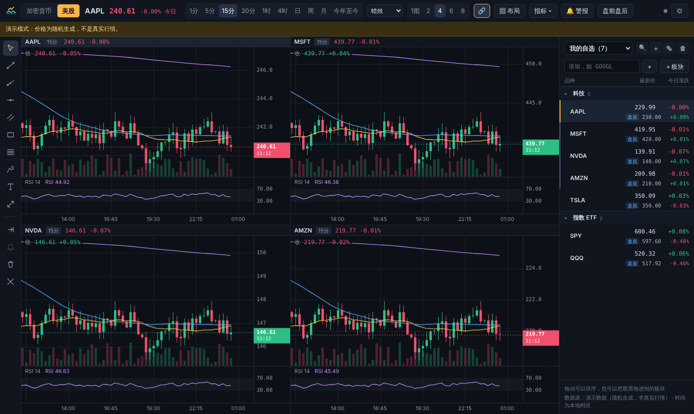
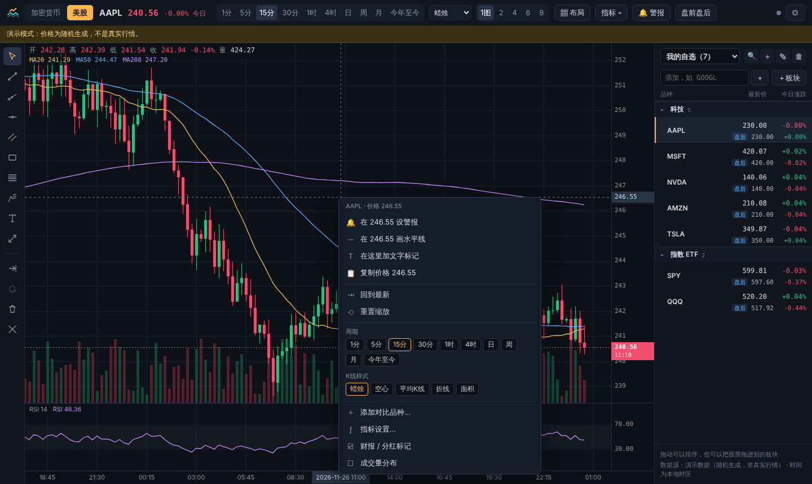
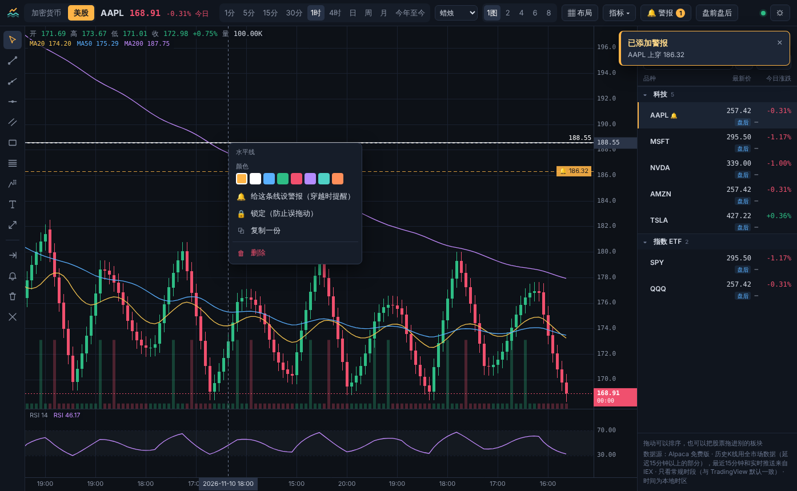
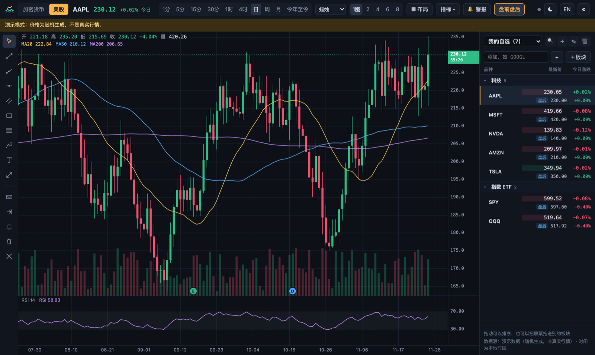
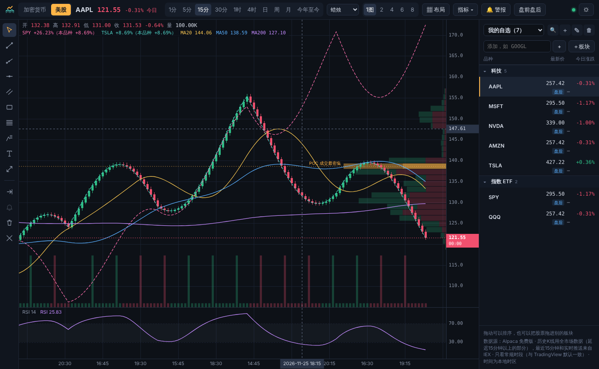

# 观潮看盘

一个原创界面的实时K线看盘程序，支持美股和加密货币。纯网页实现，原生 JavaScript 加自绘 Canvas，不依赖任何图表库，也不需要安装或构建，双击就能打开。



## 功能一览

**行情**
- 美股（Alpaca）和加密货币（OKX）实时行情，WebSocket 推送
- 周期：1分、5分、15分、30分、1时、4时、日、周、月、今年至今
- 多图同屏：1 / 2 / 4 / 6 / 8 个图，每个图的品种和周期都可以单独设置
- 多图联动：十字线和时间位置同步。周期相同的图同步缩放和平移，周期不同的图只对齐时间
- K线样式：蜡烛、空心蜡烛、平均K线（Heikin Ashi）、折线、面积
- 美股可选是否包含盘前盘后的K线

**指标与分析**
- 主图指标：MA、EMA、WMA、布林带、VWAP、SAR
- 副图指标：成交量、RSI、MACD、KDJ、ATR、OBV、CCI、WR
- 同一种指标可以加多条，参数和颜色都能自定义
- 成交量分布：按价位统计成交量，并标出成交最密集的价位（POC）
- 对比叠加：最多 3 个品种叠加在同一张图上，比较涨跌幅
- 财报、分红、拆股标记（仅美股）：鼠标移上去可看 EPS、预期和超预期幅度
- 筛选器：可按涨跌幅、放量、均线位置、突破均线、N 日新高或新低、RSI 筛选

**画线**
- 趋势线、射线、水平线、平行通道、矩形、斐波那契回撤、斐波那契扩展、文字标注、测量
- 画线可以改颜色、锁定、复制，按品种自动保存

**自选与提醒**
- 多个自选列表，列表内可分板块，支持拖动排序
- 非常规时段在价格下方另起一行，显示盘前、盘后、夜盘价格
- 警报：可按价位提醒，也可在画线被穿越时提醒。触发时弹窗、响提示音并发系统通知，还能推送到手机（ntfy、Bark）或 Discord。程序要开着才会提醒
- 备份：自选、画线、布局、警报和设置可以导出成一个文件，换电脑后导入恢复，可以选择是否包含 Key
- 布局保存：把整套多图、周期和指标设置存下来，一键切换

**右键菜单**：在K线图上右键，可以直接在这个价位设警报、画线、加标记、切换周期等。

**快捷键**：直接打字输入代码换股票，方向键平移缩放，`,` `.` 切换周期，Alt+字母选画线工具。按 `?` 查看全部快捷键。

| 右键菜单 | 画线菜单 |
|---|---|
|  |  |

| 财报和分红标记 | 对比叠加和成交量分布 |
|---|---|
|  |  |

> 截图里的行情是测试用的模拟数据。

## 怎么打开

先把仓库下载下来（绿色 Code 按钮 → Download ZIP，然后解压），再按你的系统操作：

- **Mac**：双击 `观潮看盘`（带图标的那个程序），会直接打开程序窗口。
  - 第一次如果提示「无法验证开发者」：右键点它，选「打开」，再点「打开」。
  - 也可以双击 `Start-Mac.command` 打开，不过会多一个终端窗口。
- **Windows**：双击 `Start-Windows.bat`，会用 Edge 或 Chrome 打开一个独立窗口。
- **任何系统**：直接用浏览器打开 `index.html` 也可以。

启动器会优先用 Chrome（或 Edge、Brave）的独立窗口打开，设置固定保存在一个单独的浏览器配置里。

想先看看效果，可以在地址后面加上 `?demo`，程序会用随机生成的演示数据运行，界面上会明确标注。

## 配置数据源

**加密货币**：使用 OKX 公开行情，免费，不用注册。

**美股**：使用 Alpaca Market Data，需要一个免费账号。
1. 在 [alpaca.markets](https://alpaca.markets) 注册（不需要入金），然后在控制台生成 API Key。
2. 点程序右上角的 ⚙，填入 Key ID 和 Secret，数据范围选「IEX（免费）」。

**财报日（可选）**：Alpaca 不提供财报数据。到 [alphavantage.co](https://www.alphavantage.co/support/#api-key) 免费申请一个 Key，同样填到 ⚙ 里，就能显示财报标记。免费 Key 每天可查 25 次，程序会把每只股票的结果缓存 3 天。分红和拆股直接用 Alpaca 的 Key，不需要另外配置。

**警报推送（可选）**：在 ⚙ 里填写，留空就不推送。
- ntfy：免费，不用注册。手机装 ntfy App，订阅设置里生成的主题名即可。
- Discord：在频道设置里新建一个 Webhook，把网址贴进来。
- Bark（iPhone）：填 Bark App 里显示的推送地址。

所有 Key 都只保存在你本机的浏览器里，不会上传到任何地方。

## 关于美股数据

Alpaca 免费版的限制：

- **实时成交只有 IEX 一家交易所**，约占全美成交量的 2–3%。程序的处理方式是：15 分钟以前的历史K线、昨收和收盘价都用全市场（SIP）数据，只有最近 15 分钟和实时跳动用 IEX。所以盘中最新价可能和券商软件略有差别。
- **盘前和盘后**：价格用全市场数据，延迟 15 分钟；IEX 在 08:00–17:00（美东时间）之间有实时成交，会叠加上去。
- **夜盘**（20:00 到次日 04:00）：免费版拿不到数据，夜盘时段显示的是盘后最后一笔价格。
- **订阅上限**：同时最多订阅 30 只股票，而且只能保持一条实时连接。同时打开两个窗口时，后打开的窗口会接管行情。

如果需要全市场实时数据，可以订阅 Alpaca 的付费数据套餐（Algo Trader Plus），然后在设置里把数据范围改成 SIP，不需要改代码。

## 文件结构

```
index.html          页面结构
style.css           样式
js/chart.js         K线图引擎（Canvas 绘制、画线、交互、联动）
js/indicators.js    技术指标计算
js/feed.js          数据源（OKX、Alpaca、Alpha Vantage、演示数据），统一接口
js/app.js           界面逻辑（多图、自选、警报、布局、筛选器、右键菜单）
观潮看盘.app         Mac 启动器（shell 脚本打包的 .app）
Start-Mac.command   Mac 启动脚本（会显示终端）
Start-Windows.bat   Windows 启动脚本
```

详细的操作说明见 [docs/使用说明.md](docs/使用说明.md)。

项目没有任何依赖，也没有构建步骤。改完代码后刷新页面就能看到效果。

## 免责声明

本项目只用于学习和个人看盘，不构成任何投资建议。行情数据来自第三方免费接口，可能有延迟、缺失或错误，请不要据此做交易决定。各数据源的使用请遵守其服务条款。

## 许可证

[MIT](LICENSE)
